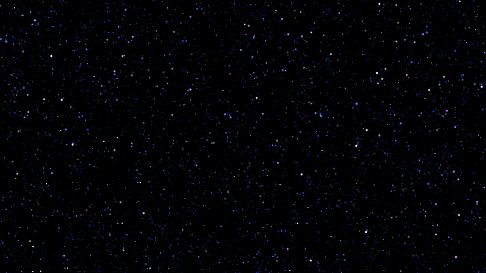

# Starfield Wallpaper



A calm, twinkling starfield for your desktop: thousands of tiny blue, violet and white stars that appear, glow
and fade while they drift slowly down and to the right, like falling stars.

* Free, works on **Windows, macOS and Linux (Ubuntu)**.
* A dark, quiet design that sits nicely behind your windows and icons.

You do not have to program anything. Pick your system below, install one small free app, give it a file, done.

## Quick start

| Your computer | Free app that plays it | The file to give it |
|---|---|---|
| **Windows** | [Lively Wallpaper](https://github.com/rocksdanister/lively) | `starfield-endless.html` |
| **Mac** | [Plash](https://sindresorhus.com/plash) | the web address of `starfield-endless.html` |
| **Ubuntu** | [Hidamari](https://github.com/jeffshee/hidamari) | `starfield-endless.html` |

Not sure how to get the file? On this page click `starfield-endless.html`, then the **Download raw file** button
(the small arrow icon above the file). Or click the green **Code** button, choose **Download ZIP**, and unzip it.

Want to see it first? Double-click `starfield-endless.html`. It opens in your web browser (press **F11** for full
screen, and **F11** again to leave it). The mouse pointer is hidden while it is over the page.

Step by step guides: [Windows](#windows) | [Mac](#mac) | [Ubuntu](#ubuntu) | [other Linux](#other-linux)

## Which file should I use?

| File | What it is | Use it when |
|---|---|---|
| `starfield-endless.html` | **The live wallpaper that never repeats.** One small web page (about 0.5 MB) that draws the stars live at your screen's own sharpness. Little patches of the sky are refreshed at random moments, so you never notice a loop. | **Start here.** |
| `starfield.html` | The same sky as a plain 3 second loop. Uses a bit less power. | Your computer is slow, or you run on battery a lot. |
| `build-walpaper-mp4.py` | Makes a **video** (MP4) of the starfield. | Your wallpaper app only plays videos. |
| `build-walpaper-png.py` | Makes a **still picture** (PNG) of the starfield. | You want no extra app at all. |
| `build-html.py` and `build-html-endless.py` | Make the two pages above from scratch, with your own colours and settings. | You like to tinker. You can ignore these. |

Both pages are completely self-contained: no internet connection, no extra files.

## Windows

**Lively Wallpaper** is free and open source. It runs on Windows 10 (a recent version) and Windows 11.

1. Install Lively from the [Microsoft Store](https://apps.microsoft.com/store/detail/9NTM2QC6QWS7), or download the
   installer from [its releases page](https://github.com/rocksdanister/lively/releases).
2. Download `starfield-endless.html` (see [Quick start](#quick-start)).
3. Open Lively and **drag `starfield-endless.html` into its window**. (Lively's own page says you can drag and drop
   web pages and media onto it.) If it asks for a title or details, you can leave them as they are and click **OK**.
4. Click the new starfield in Lively's library. It is now your wallpaper.

Lively stays in the notification area next to the clock. Right-click its icon there to change or quit.
Windows may show a SmartScreen warning when you run the installer from GitHub. Installing from the Microsoft Store
avoids that.

*Other ways:*

* **Wallpaper Engine** (paid, on Steam): put `starfield-endless.html` in a folder of its own, then drag the file onto
  the **Create Wallpaper** button in the Wallpaper Engine editor.
* **No app at all:** run `build-walpaper-png.py` (see [Make your own](#make-your-own-with-the-python-scripts)) and
  right-click the picture it makes, **Set as desktop background**. It is a still picture, so it will not move.

## Mac

You have two good choices. The first one looks best.

### Option 1: Plash and the web address (looks best)

**Plash** is a free app that shows a web page as your desktop wallpaper. The starfield is a web page.

1. Install [Plash](https://sindresorhus.com/plash) (from the Mac App Store, or from that page; the page also
   lists versions for older versions of macOS).
2. Add this address in Plash:

   ```
   https://TISnoob.github.io/starfield-walpaper/starfield-endless.html
   ```

   Add it from Plash's icon in the menu bar, or paste this into the Terminal app (this is the command Plash's page
   documents for adding a website):

   ```
   open -g 'plash:add?url=https://TISnoob.github.io/starfield-walpaper/starfield-endless.html'
   ```

3. In Plash's menu, also switch on its start-at-login option if it has one, so the stars come back after a restart.

This loads the page from the internet each time Plash starts, then everything runs on your Mac.

**Without the internet** you can serve the file from your own Mac instead. Plash's page says that local file
(`file://`) addresses are not supported when you add a website with that command, so run a tiny local web server
(Python is needed, see
[What you need](#what-you-need)). Download this repository, open Terminal, type `cd ` (with a space), drag the
folder into the Terminal window, press Enter, then:

```
python3 -m http.server 8765 --bind 127.0.0.1
```

and give Plash the address `http://127.0.0.1:8765/starfield-endless.html`. Keep that Terminal window open.

### Option 2: a video wallpaper app

[LiveWallpaper](https://github.com/ducbao414/live-wallpaper) is a free, open-source app for macOS 13 (Ventura) or
newer that plays a video as your wallpaper. Install it with Homebrew (`brew install ducbao414/tap/live-wallpaper`)
or download `LiveWallpaper.zip` from its releases page.

1. Make the video with `build-walpaper-mp4.py` (see [Make your own](#make-your-own-with-the-python-scripts)). Use
   your screen's real size. To be safe on a Mac, ask for the plain, widely supported kind of video (`--chroma 420`):

   ```
   python3 build-walpaper-mp4.py --width 2880 --height 1800 --scale 2 --chroma 420
   ```

   (`2880 x 1800` is an example. Look up your Mac's size in System Settings, Displays.)
2. Open LiveWallpaper, add the video and click **Set as Wallpaper**. After you close its window, use its icon in
   the menu bar to control it.

### No app at all

Run `build-walpaper-png.py` (for example `python3 build-walpaper-png.py --width 2880 --height 1800 --scale 2`) and
add the picture in **System Settings, Wallpaper, Add Photo**. It is a still picture, so it will not move.

## Ubuntu

**Hidamari** is a free app that plays a web page or a video as your wallpaper. It works with the default Ubuntu
desktop (GNOME).

1. Install it. In a terminal:

   ```
   sudo apt install flatpak
   flatpak remote-add --if-not-exists flathub https://dl.flathub.org/repo/flathub.flatpakrepo
   flatpak install flathub io.github.jeffshee.Hidamari
   ```

   Start it from the app grid (or `flatpak run io.github.jeffshee.Hidamari`). If its icon is missing, log out and
   in again.
2. In Hidamari choose **Web Page** and give it this address, then press the arrow:

   ```
   https://TISnoob.github.io/starfield-walpaper/starfield-endless.html
   ```

3. Switch on its start-at-login option in its settings so the stars come back after a restart.

**Prefer to use your own copy of the file?** Hidamari runs in a sandbox and can only see the folder
`~/Videos/Hidamari`, so copy `starfield-endless.html` there and give Hidamari this address (with your own user name):

```
file:///home/YOUR_LINUX_USER_NAME/Videos/Hidamari/starfield-endless.html
```

If the page stays black with a `file://` address, serve the folder instead. Run this and keep the terminal open:

```
cd ~/Videos/Hidamari && python3 -m http.server 9000 --bind 127.0.0.1
```

and use `http://127.0.0.1:9000/starfield-endless.html` as the address.

*Other ways:*

* **Video wallpaper:** make `starfield_1920x1080.mp4` with `build-walpaper-mp4.py`, copy it to
  `~/Videos/Hidamari`, and pick it in Hidamari. Or use the
  [Hanabi](https://github.com/jeffshee/gnome-ext-hanabi) GNOME extension, which plays a video as the wallpaper
  (see its page for your GNOME version).
* **No app at all:** run `build-walpaper-png.py`, then right-click the picture in the Files app and choose **Set as
  Wallpaper** (or **Settings, Background, Add Picture**). A still picture does not move.

Hidamari keeps running after you close its window. To stop it, quit it from the background apps list in Quick
Settings (top-right corner) or from **Settings, Apps**.

## Other Linux

* **KDE Plasma 6:** install the [Smart Video Wallpaper Reborn](https://github.com/luisbocanegra/plasma-smart-video-wallpaper-reborn)
  plugin (right-click the desktop, **Desktop and Wallpaper**, **Get New Plugins**, search for it), set the
  **Wallpaper type** to it, add the MP4 from `build-walpaper-mp4.py`, and click **Apply**. Its page lists packages
  for Arch (AUR) and Fedora too.
* **Sway and other wlroots-based Wayland compositors:**
  [mpvpaper](https://github.com/GhostNaN/mpvpaper) plays a video as the background, for example
  `mpvpaper -o "no-audio --loop-playlist" ALL starfield_1920x1080.mp4` (see its page; it is made for wlroots-based
  compositors, not for GNOME or KDE).
* **GNOME on Fedora, Debian and others:** the Hidamari steps above should work the same, since it comes as a Flatpak.
* **Anything else:** make a picture with `build-walpaper-png.py` and set it as your background in the usual way.

## Make your own with the Python scripts

You do **not** need this part to use the wallpaper: the two `.html` files above are ready to go. The scripts let you
choose the colours, how many stars there are, how fast they drift, and the size of the video or picture for your
screen. Each script is one file that works on its own.

### What you need

* **Python 3.8 or newer** (free). Check with `python3 --version` (on Windows: `py --version`).
  * **Windows:** install it from [python.org/downloads](https://www.python.org/downloads/) and tick
    *Add python.exe to PATH* in the installer. Then run scripts with `py` (or `python`) instead of `python3`.
  * **Mac:** install it from [python.org/downloads](https://www.python.org/downloads/) or with Homebrew
    (`brew install python`).
  * **Ubuntu:** it is already there.
* **ffmpeg**, a free video tool, but **only for the video script**:
  * Windows: `winget install Gyan.FFmpeg` (then open a new terminal window)
  * Mac: `brew install ffmpeg` (needs [Homebrew](https://brew.sh))
  * Ubuntu: `sudo apt install ffmpeg`

There is nothing else to install: the scripts use only what comes with Python.

### Open a terminal in the folder with the scripts

* **Windows:** open the folder in File Explorer, click the address bar, type `cmd`, press Enter.
* **Mac:** open the Terminal app, type `cd ` (with a space), drag the folder into the window, press Enter.
* **Ubuntu:** right-click an empty spot in the folder and choose **Open in Terminal**.

### The four scripts

| Run this | It writes | Takes |
|---|---|---|
| `python3 build-html-endless.py` | `starfield-endless.html`, the page that never repeats | a few seconds |
| `python3 build-html.py` | `starfield.html`, the plain 3 second loop page | a few seconds |
| `python3 build-walpaper-png.py` | `starfield_1920x1080.png`, a still picture | a few seconds |
| `python3 build-walpaper-mp4.py` | `starfield_1920x1080.mp4`, a 6 second looping video (about 26 MB) | half a minute or more |

(On Windows type `py` instead of `python3`.) Files appear in the folder you are in. Run a script again and it
replaces its file. To see everything a script can do, run it with `--help`, for example
`python3 build-walpaper-mp4.py --help`.

### Make a picture or video that fits your screen

Give the real size of your screen in pixels (for example from your system's display settings):

```
python3 build-walpaper-png.py --width 2560 --height 1440
python3 build-walpaper-mp4.py --width 2560 --height 1440
```

On a very sharp screen (4K, or a Mac with a Retina display) the stars would look tiny, so make them 2 times bigger:

```
python3 build-walpaper-png.py --width 3840 --height 2160 --scale 2
python3 build-walpaper-mp4.py --width 3840 --height 2160 --scale 2
```

If your video player shows a black screen or odd colours, use the more widely supported kind of video. Add
`--chroma 420`, and `--scale 2` as well so the tiny stars keep their colour:

```
python3 build-walpaper-mp4.py --chroma 420 --scale 2
```

Video files are big, because every star is a sharp little dot: the default 6 second video at 1920 x 1080 is about
26 MB, and bigger screens make bigger files. For a smaller file add `--seconds 3` (your wallpaper app plays the video
over and over anyway) and/or `--crf 22` (a slightly softer picture). Both together give about 6.5 MB at 1920 x 1080:

```
python3 build-walpaper-mp4.py --seconds 3 --crf 22
```

Several different pictures for your system's background slideshow:

```
python3 build-walpaper-png.py --count 10
```

### Choose how the sky looks (all four scripts)

| Option | What it does | Default |
|---|---|---|
| `--palette NAME` | Star colours: `default` (blue, violet, white), `ice` (blue and cyan), `ember` (orange and gold), `aurora` (green, teal, violet) or `mono` (silver) | `default` |
| `--density X` | How many stars. `0.5` is half as many, `2` is twice as many | `1` |
| `--speed X` | How fast they drift. `0.5` is half as fast, `0` makes them stand still | `1` |
| `--seed N` | Another number makes another sky | `1` |
| `--frames N` | Length of the animation loop in frames, 20 per second. Longer is harder to notice, but makes bigger files | `60` (3 seconds) |
| `--sky COLOUR` | The faint haze along the bottom: `navy`, `black`, `purple`, `blue`, or a colour like `#101830` | `navy` |

Examples:

```
python3 build-html-endless.py --palette ice
python3 build-html-endless.py --palette ember --density 1.5 --speed 0.6 --out my-sky.html
python3 build-walpaper-mp4.py --palette aurora --width 2560 --height 1440
```

Options that belong to one script:

| Script | Option | What it does |
|---|---|---|
| all | `--out NAME` | The file name to write |
| `build-html-endless.py` | `--life N`, `--fade N` | Seconds before a patch of sky is refreshed (default 5) and how long that change takes (default 0.6, `0` = instant) |
| `build-html.py` | `--layout-seed N` | Another arrangement of the sky's patches |
| `build-walpaper-png.py` | `--width`, `--height`, `--scale` | Size of the picture, and how big the stars are |
| `build-walpaper-png.py` | `--count N`, `--frame N` | How many different pictures to make; which moment of the animation the first one shows |
| `build-walpaper-mp4.py` | `--width`, `--height`, `--scale` | Size of the video, and how big the stars are |
| `build-walpaper-mp4.py` | `--seconds N` | About how long the video is (default 6). The same 3 second loop is repeated to reach it |
| `build-walpaper-mp4.py` | `--crf N` | Quality: lower is sharper and bigger (default 16, `12` = very high, `22` = small file) |
| `build-walpaper-mp4.py` | `--chroma 444\|420` | `444` keeps star colours exact (default). `420` plays on more devices |

### Settings of the web pages

You can add settings to the end of the page's address (or, for a file on your computer, to the file name in the
wallpaper app's address box), for example `starfield-endless.html?life=3&scale=2`:

| Setting | What it does | Default |
|---|---|---|
| `scale=2` | Draws every star 2 times bigger (good for 4K screens) | automatic |
| `seed=12` | A fixed arrangement of the sky (the endless page picks a new one each time it opens) | random |
| `life=5` | *Endless page only.* Average seconds before a patch of sky is refreshed. Smaller = more change | `5` |
| `fade=0.6` | *Endless page only.* Seconds a change takes. `0` = instant, which is the lightest on your computer | `0.6` |

## Questions

**Does it use a lot of power?** An animated wallpaper always uses some, more than a still picture. The page draws
only 20 times a second and pauses while it is hidden. `starfield.html` is the lighter of the two pages, and
`starfield-endless.html?fade=0` is lighter than the default. Many wallpaper apps also have a setting to pause the
wallpaper while another program is full screen; look in the app's settings.

**Does it connect to the internet?** No. The pages contain no links and load nothing. (Only the web-address options
above fetch the page itself from GitHub once, when your wallpaper app starts.)

**It looks black in my wallpaper app.** First check that the file works on its own: double-click
`starfield-endless.html` and it should open in your browser. If it does, try `starfield.html` in the app, or serve
the page locally with `python3 -m http.server` as shown in the guides.

**The stars are too small on my sharp screen.** Add `?scale=2` to the page's address, or use `--scale 2` when you
make a picture or video.

**How do I stop or remove it?** Quit the wallpaper app (Lively: right-click its tray icon; Plash: its menu bar icon;
Hidamari: Quick Settings). Then pick a normal wallpaper in your system settings.

**Why is the video softer than the page?** Video compression dims tiny dots a little; a pixel-sized star is the
hardest thing for a video. The page draws every star exactly. A video is also always a loop, so for a sky that never
repeats use the endless page.

**What has been tested?** Both pages were checked in a Chromium-based browser (the engine of Chrome and Edge): what
they draw matches the Python code pixel for pixel, they keep 20 frames per second, and they ran 30 simulated minutes
without errors. The scripts were run on Python 3.8, 3.11, 3.12, 3.13 and 3.14 on Linux and give identical files on all
of them. The video script was checked with ffmpeg 6. It has not been tried on Windows or macOS computers, in Safari or
Firefox, or inside each wallpaper app, so tell us (open an issue) if something does not work for you.

## How it works

The starfield is built from a small animated "tile" (540 x 80 pixels, a 3 second loop). Every star in it is made by
a few lines of code: it appears at a random spot, brightens and fades again within a fraction of a second to a couple
of seconds, and drifts down and to the right, with colours drawn from a small palette. Dim dust, small stars, bigger
stars and a few glittering ones are mixed so the sky feels deep.

Repeating one tile over a whole screen would show a grid and every star would flash in step. So the screen is covered
with randomly sized patches, each showing a different part of the tile at a different moment of the loop. The endless
page goes a step further: every patch is swapped for a new random one at its own random moment, a few small blocks at a
time, so no corner of the screen ever repeats.

The page and the picture/video scripts use the same random number generator and the same layout rules, so
`?seed=12` on the page and `--layout-seed 12` in the scripts give the same arrangement.

## Credits

This project is inspired by the Firefox theme
**[Purple starfield - Animated](https://addons.mozilla.org/en-US/firefox/addon/purple-starfield-animated)** by Dex.
Only the *idea* (a drifting purple-and-blue starfield) comes from there. **No images, animation frames, code or other
assets from that theme were used.** Every star here is generated by the Python scripts in this repository, and the web
pages are made by those scripts. This project is not affiliated with or endorsed by the theme's author or by Mozilla.

Lively Wallpaper, Plash, Hidamari, LiveWallpaper, Hanabi, Smart Video Wallpaper Reborn, mpvpaper, Wallpaper Engine,
Python and ffmpeg belong to their own authors; they are mentioned here only so you can find them.

## Licence

[MIT](LICENSE): free to use, change and share, also for other projects, as long as the licence text stays with it.
